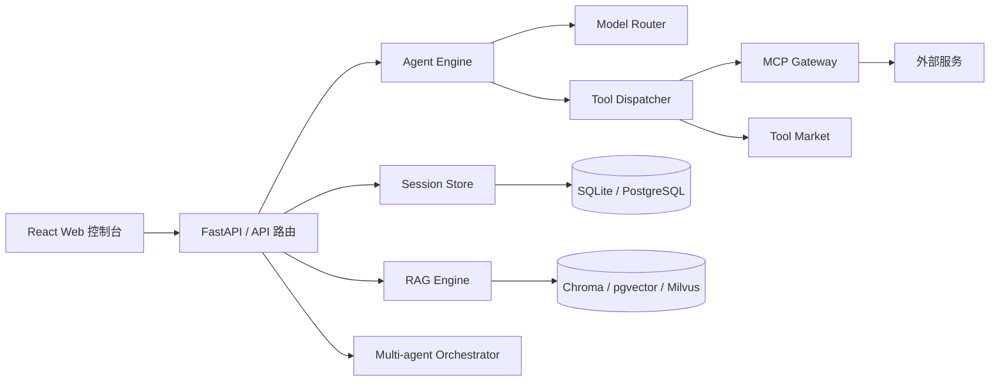

# AI Agent Platform — 架构文档

> **文档状态：** 基于 `v1.0.0` 及后续本地安全运行时改进整理（2026-08）。本文将“已运行能力”与外部生产依赖分开描述，避免将可选适配器误作已配置服务。逐项代码和测试证据见 [工程证据与面试说明](engineering-evidence.md)。

## 1. 系统概览

AI Agent Platform 是一个以 FastAPI 为服务入口、以 React 为控制台的 Agent 实验平台。它组合了模型路由、工具调度、会话与记忆、RAG、MCP、任务编排和安全检查等能力。

## 2. 当前运行时架构

### 2.1 启动与组合根

`app.py` 是当前唯一的组合根：它读取 `config.yaml` 和环境变量，创建 FastAPI 应用，并在生命周期中直接初始化核心服务与注册 API 路由。

当前已直接初始化的能力包括：Agent 引擎、三级安全检查、沙箱、锁、降级管理、任务队列、MCP 网关、会话存储、长期记忆、RAG、上下文树、工具市场、多智能体、检查点、HITL、评估、追踪收集器及 Telegram 适配器。

**边界说明：** `core/` 中已经具备 `PluginManager`、`EventBus` 和 `DIContainer`，但当前启动路径尚未使用它们完成插件发现与生命周期编排。因此，系统目前是“模块化单体 + 预备微内核”，而非完全运行时插件化系统。

### 2.2 目录与职责

| 目录 | 当前职责 |
|---|---|
| `app.py` | 应用工厂、生命周期、依赖组合、路由注册 |
| `core/` | 插件协议、插件管理器、事件总线、依赖注入容器 |
| `plugins/agent_engine/` | 模型路由、Agent 循环、工具调度 |
| `plugins/conversation/` | 会话与消息持久化 |
| `plugins/memory/` | 长短期记忆与归档 |
| `plugins/rag_engine/` | 摄取、切分、检索、重排与引用 |
| `plugins/mcp_gateway/` | MCP 服务器及 GitHub 适配器 |
| `plugins/tool_market/` | 工具注册、市场与内置工具 |
| `plugins/security/` | 输入、执行和输出安全控制 |
| `plugins/multi_agent/` | 编排、通信与共享黑板 |
| `plugins/web_ui/api/` | REST 与 SSE API |
| `web/` | React + Vite 控制台源码 |
| `services/` | 面向 API 的服务编排层 |
| `shared/` | 共享模型、数据库与工具函数 |

## 3. 关键请求流

### 3.1 对话与工具调用

1. Web 控制台通过 REST 创建或选择会话，并通过 SSE 接收流式对话输出。
2. Chat API 将消息交给 `AgentEngine`。
3. 引擎经 `ModelRouter` 选择模型，构建上下文，并调用 LLM。
4. 若模型请求工具，`ToolDispatcher` 执行可并行的独立工具调用。
5. 结果回写模型上下文，直到模型返回文本或达到终止条件。
6. 会话、消息、记忆和审计数据按各自后端的能力持久化。

### 3.2 风险操作

工具调用应依次经过输入检查、执行检查和输出脱敏。文件写入、终端、代码执行、浏览器和 GitHub 写操作属于高风险能力，应该在生产配置中要求显式审批与可追溯审计。

### 3.3 中断、重试与恢复边界

会话和消息以客户端请求标识去重，中断后重发不会重复保存同一用户输入。多智能体计划持久化后，进程重启会把未完成运行态恢复为等待调度状态；取消和失败重试由编排器显式执行。

恢复不等于事务回滚：当前不保存流式生成的逐 Token 检查点，也不自动撤销已经发生的外部工具副作用。成功工具调用由本地账本按会话、调用 ID、工具名和参数摘要去重，检查点使用原子替换并可跳过损坏快照；写工具仍必须经过审批。进程在副作用发生后、结果落盘前崩溃，以及跨进程并发执行，不属于 exactly-once 保证，仍需具体工具提供条件写入、下游幂等键或补偿操作。审计日志记录 `trace_id`、审批和工具生命周期事件，但递归移除密钥、令牌、Cookie 等敏感字段。

## 4. 数据与状态

| 状态 | 默认实现 | 生产建议 |
|---|---|---|
| 会话与消息 | SQLite | PostgreSQL + 迁移管理 |
| 长期记忆 / RAG | JSON 元数据 + 内置检索或 ChromaDB；支持文档级删除 | pgvector 或 Milvus，按租户隔离 |
| 锁与缓存 | 可选 Redis，缺省时乐观模式 | Redis 高可用部署 |
| API Key / JWT 撤销 | 进程内存 | 加密持久化存储与密钥轮换 |
| 检查点 | 插件存储 | 数据库持久化、版本化恢复策略 |

任何包含用户内容、工具参数、模型输出或检索片段的存储，都应定义：保留期限、删除机制、租户边界和审计访问权限。

## 5. 接口与前端

后端以 FastAPI 路由提供服务；聊天流式输出目前采用 **SSE**。WebSocket 协议不属于当前已接入的服务端能力，若需要双向实时协作、子代理日志或审批通知，应单独设计并实现协议、鉴权和背压策略。

前端位于 `web/`，采用 React、TypeScript、Vite、Tailwind 和 Zustand。界面包含对话、工具市场、知识库、多智能体、分析和设置页面。构建产物可由后端静态入口提供。

## 6. 安全基线

当前认证模块提供 API Key 与 JWT 的基础实现，但默认配置关闭认证，且密钥、注销令牌保存于进程内存。这些实现适合本地开发与原型验证，**不能直接作为生产认证方案**。

生产部署必须满足：

- 默认拒绝未认证请求；将认证依赖或中间件统一应用于受保护 API。
- 禁止使用默认 JWT 密钥，并使用密钥管理服务存储、轮换和撤销凭据。
- 以持久化身份、角色和资源授权替代临时用户名。
- 工具权限按用户、组织、项目与操作级别授权；写操作要求审批记录。
- 限制 CORS 来源、记录审计日志，并避免在日志中保存密钥和敏感提示词。

## 7. 可观测性与可靠性

仓库提供结构化日志、健康检查、指标和追踪相关模块，但它们尚未在默认启动链中形成完整的 OpenTelemetry / Prometheus 管道。部署前应补齐：

- 为 HTTP、Agent、模型、工具和 MCP 调用生成并透传 `trace_id`。
- 暴露 Prometheus 指标：请求量、错误率、延迟、令牌与成本、队列深度、工具审批。
- 配置健康、就绪和依赖检查端点；区分可重试、降级和人工介入的错误。
- 建立延迟、错误率、预算和队列积压的告警规则。

性能目标必须由可复现的 k6/Locust 场景、环境规格、数据规模和基准结果共同定义；在没有这些证据前不应将目标值描述为已达成指标。

## 8. 演进路线

### P0：真实架构与生产安全

- 让 README、配置和本文档持续反映当前实现。
- 在生产配置中强制认证、授权、持久化密钥和审批审计。
- 明确外部工具的网络、文件系统和数据访问边界。

### P1：完成微内核落地

- 在 `app.py` 中初始化 DI 容器、事件总线和插件管理器。
- 统一插件清单、依赖声明、加载顺序、健康状态和关闭钩子。
- 将直接导入的可选能力改为明确的插件注册；保留组合根作为唯一装配点。

### P2：运行可观测性与弹性

- 接入端到端追踪、指标导出和仪表盘。
- 对 LLM、MCP、向量库和队列添加超时、重试、熔断和预算策略。
- 用故障演练和压测验证降级链。

### P3：协作能力

- 如有真实双向实时需求，再引入鉴权后的 WebSocket 通道。
- 为多智能体定义任务状态机、取消语义、配额、隔离与可恢复检查点。

## 9. 架构决策记录

重大变更应在 `docs/adr/` 中以 ADR 记录：问题、备选方案、决策、后果、迁移步骤和回滚方式。建议首先记录：插件运行时、认证策略、向量库选择、工具沙箱和流式协议。

## 10. 文档维护规则

- 新增或删除运行时模块时，同步更新第二节目录表。
- 任何“已完成”“支持”“性能指标”声明必须给出代码入口或测试/基准链接。
- 设计提案需明确标记为“目标”或置于 ADR，避免和已实现功能混写。
- 每个发布版本在文档顶部更新所依据的分支、提交和日期。
