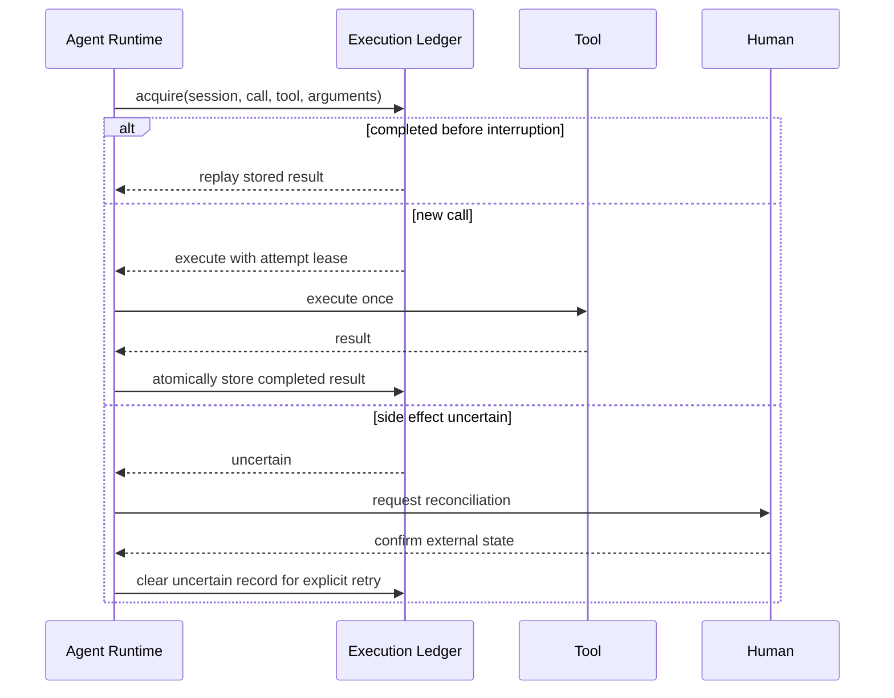

# Architecture

The project is a modular monolith: one process owns runtime state, while explicit plugin and API
boundaries keep features replaceable and testable. It is intentionally local-first and does not
claim production readiness.

```mermaid
flowchart LR
    UI[React Web UI] --> API[FastAPI boundary]
    API --> AR[Agent Runtime]
    AR --> MR[Model Router]
    AR --> TD[Tool Dispatcher]
    AR --> SS[Session Store]
    AR --> CT[Checkpoint Store]
    TD --> AP[Approval Request]
    TD --> EL[Execution Ledger]
    TD --> SB[Policy and Sandbox]
    TD --> TOOLS[Local / MCP Tools]
    AR --> TR[Redacted Traces]
    TR --> EV[Offline Evaluation]
    PR[Plugin Runtime] --> AR
    PR --> HL[/health and /ready]
```

## Recovery sequence



## Code boundaries

- `app.py` is the composition root and public application factory.
- `core/runtime_assembly.py` publishes single-owner components and activates plugins.
- `core/service_lifecycle.py` performs failure-isolated resource shutdown.
- `plugins/web_ui/routes.py` owns versioned router registration.
- `core/plugin_manager.py` owns discovery, dependency ordering, lifecycle, extensions, and health.
- `plugins/checkpoint/execution_ledger.py` is authoritative for idempotent tool recovery.
