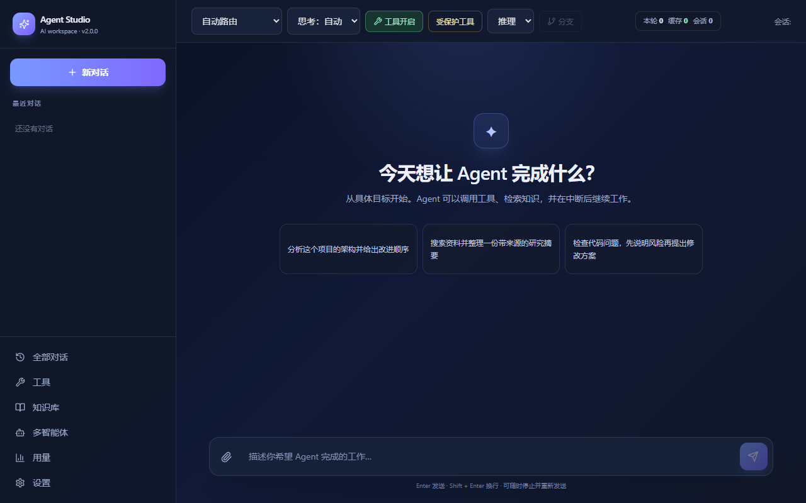

# Recovery showcase

This deterministic demo proves the project's flagship path without API keys or network access:

1. Execute a tool call and atomically persist its successful result.
2. Recreate the dispatcher and ledger to simulate a process restart.
3. Submit the same Session and call ID and verify the stored result is replayed without another
   side effect.
4. Simulate a connection loss after a different tool may have produced a side effect.
5. Recreate the runtime again and verify the ambiguous call fails closed as an Uncertain
   Execution.
6. Resolve the ambiguity through HITL, persist a redacted Trace, and run the offline Agent Eval.

Run it from the repository root:

```powershell
uv run --frozen python -m scripts.run_resume_demo `
  --output data/release/resume-demo.json
```

The command exits non-zero unless every check passes. The JSON report includes the benchmark
environment, side-effect count, audit event names, Trace summary, evaluation metrics, and
regression gate result.

The UI smoke test can also refresh the portfolio screenshot while validating interactions:

```powershell
uv run --frozen python -m scripts.run_browser_smoke `
  --screenshot docs/images/ui-overview.png
```


